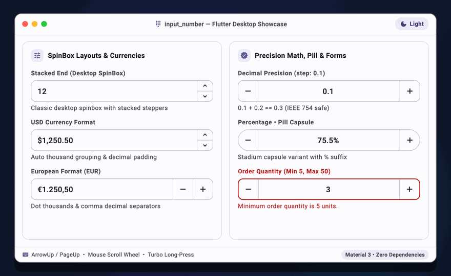
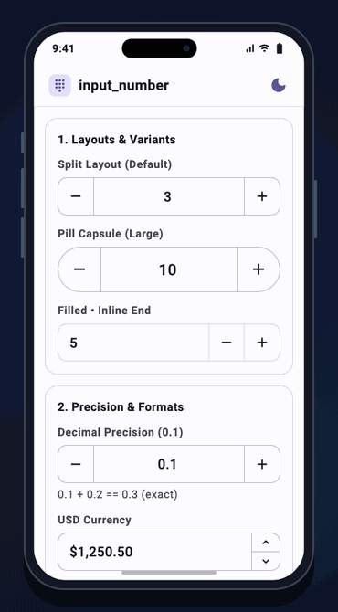

# input_number

<p align="center">
  <a href="https://pub.dev/packages/input_number">
    
  </a>
</p>

[](https://pub.dev/packages/input_number)
[](https://opensource.org/licenses/MIT)
[](https://flutter.dev)
[](https://pub.dev/packages/input_number)
[](https://humanize.id)

A modern, customizable, and zero-dependency numeric input and stepper widget library for Flutter. Built for Material 3 with precision-safe decimal arithmetic, flexible stepper button layouts, currency & unit formatting, long-press turbo acceleration, keyboard/mouse wheel navigation, and full `FormField` support.

> 🌟 Supported & Powered by [Humanize AI](https://humanize.id)

---

## 🎬 Live Preview

<table>
  <thead>
    <tr>
      <th align="center">🖥️ Desktop (macOS / Web / Windows / Linux)</th>
      <th align="center">📱 Mobile (iOS / Android)</th>
    </tr>
  </thead>
  <tbody>
    <tr>
      <td align="center" valign="middle">
        
      </td>
      <td align="center" valign="middle">
        
      </td>
    </tr>
  </tbody>
</table>

> Real Flutter widget previews demonstrating Material 3 **Light & Dark** themes, `split` / `stackedEnd` / `inlineEnd` layouts, `outlined` / `filled` / `pill` variants, IEEE 754 precision-safe stepping (`0.1 + 0.2 == 0.3`), currency/European/percentage/unit formatting, `InputNumberController`, and live `InputNumberFormField` validation.

---

## ✨ Features

- 🚀 **Precision-Safe Decimal Math**: Eliminates IEEE 754 floating-point drift (`0.1 + 0.2 == 0.3` guaranteed) via `NumberMath`.
- 🎛️ **4 Stepper Button Layouts** (`InputNumberButtonLayout`):
  - `InputNumberButtonLayout.split` (`[-] 12 [+]`) — ideal for mobile & e-commerce quantity pickers.
  - `InputNumberButtonLayout.stackedEnd` (`12 [▲/▼]`) — classic desktop spinbox layout.
  - `InputNumberButtonLayout.inlineEnd` (`12 [-][+]`) — compact trailing actions.
  - `InputNumberButtonLayout.none` — clean numeric field with keyboard/wheel stepping.
- 🎨 **4 Visual Variants & 3 Sizes**:
  - `outlined`, `filled`, `underlined`, and `pill` (stadium capsule).
  - `small`, `medium`, and `large` presets with full override support via `InputNumberStyle`.
- 💱 **Built-in Formatting & Presets** (`InputNumberFormat`):
  - Thousand grouping separators (`,` or `.`), custom decimal separators, prefixes, suffixes, and fixed decimal padding.
  - Ready-to-use presets: `InputNumberFormat.standard()`, `InputNumberFormat.decimal()`, `InputNumberFormat.currency()`, `InputNumberFormat.european()`, `InputNumberFormat.percentage()`, and `InputNumberFormat.unit()`.
- ⚡ **Long-Press Auto-Repeat with Turbo Acceleration**: Hold down `+` or `-` to step continuously with progressive speed-up.
- 🖥️ **Desktop & Web Ready**:
  - `ArrowUp` / `ArrowDown` for standard step, `PageUp` / `PageDown` for `largeStep`.
  - Mouse scroll wheel stepping when focused.
- 📋 **Seamless Form Integration**: `InputNumberFormField` integrates directly with Flutter's `Form`, `validator`, `onSaved`, `reset`, and `AutovalidateMode`.
- 🎮 **Rich Programmatic Controller** (`InputNumberController`): Extends `ValueNotifier<num?>` with `increment()`, `decrement()`, `setValue()`, `reset()`, `clear()`, and dynamic bound updates.

---

## 📦 Installation

Add `input_number` to your `pubspec.yaml`:

```yaml
dependencies:
  input_number: ^1.0.3
```

Or install via the Flutter CLI:

```bash
flutter pub add input_number
```

---

## 🚀 Quick Start

```dart
import 'package:flutter/material.dart';
import 'package:input_number/input_number.dart';

class QuantitySelector extends StatelessWidget {
  const QuantitySelector({super.key});

  @override
  Widget build(BuildContext context) {
    return InputNumber(
      labelText: 'Quantity',
      initialValue: 1,
      min: 1,
      max: 99,
      step: 1,
      onChanged: (value) {
        debugPrint('Current value: $value');
      },
    );
  }
}
```

---

## 📖 Usage Examples

### 1. Button Layouts & Visual Variants

```dart
// Desktop SpinBox style with stacked buttons on the right
InputNumber(
  initialValue: 10,
  min: 0,
  max: 100,
  buttonLayout: InputNumberButtonLayout.stackedEnd,
  variant: InputNumberVariant.outlined,
)

// Pill / Capsule style for shopping cart items
InputNumber(
  initialValue: 2,
  min: 1,
  max: 20,
  size: InputNumberSize.large,
  buttonLayout: InputNumberButtonLayout.split,
  variant: InputNumberVariant.pill,
)
```

### 2. Currency, Percentage, and Unit Formatting

```dart
// USD Currency ($1,250.50)
InputNumber(
  labelText: 'Price (USD)',
  initialValue: 1250.5,
  min: 0,
  step: 10,
  precision: 2,
  format: const InputNumberFormat.currency(symbol: r'$'),
)

// European Format (€1.250,50)
InputNumber(
  labelText: 'Amount (EUR)',
  initialValue: 1250.5,
  min: 0,
  step: 50,
  precision: 2,
  format: const InputNumberFormat.european(symbol: '€', padDecimals: true),
)

// Percentage (15.5%)
InputNumber(
  labelText: 'Discount Rate',
  initialValue: 15.5,
  min: 0,
  max: 100,
  step: 0.5,
  precision: 1,
  format: const InputNumberFormat.percentage(),
)

// Physical / Measurement Units (1,250 kg)
InputNumber(
  labelText: 'Payload Weight',
  initialValue: 1250,
  min: 0,
  step: 25,
  precision: 0,
  format: const InputNumberFormat.unit(unit: 'kg'),
)
```

### 3. Programmatic Control with `InputNumberController`

```dart
final controller = InputNumberController(
  value: 10,
  min: 0,
  max: 100,
  step: 5,
);

// Bind to InputNumber and listen with ValueListenableBuilder<num?>
InputNumber(
  controller: controller,
  showClearButton: true,
);

// Programmatic actions
controller.increment();     // 15
controller.decrement(2);    // 13
controller.setValue(80);    // 80
controller.reset();         // 10
controller.clear();         // null
```

### 4. Form Validation with `InputNumberFormField`

```dart
InputNumberFormField(
  labelText: 'Order Units',
  initialValue: 5,
  min: 1,
  max: 100,
  step: 1,
  precision: 0,
  autovalidateMode: AutovalidateMode.onUserInteraction,
  validator: (value) {
    if (value == null) return 'Quantity is required';
    if (value < 5) return 'Minimum order is 5 units';
    return null;
  },
  onSaved: (value) {
    debugPrint('Saved order quantity: $value');
  },
)
```

### 5. Custom Styling with `InputNumberStyle`

```dart
InputNumber(
  initialValue: 42,
  style: InputNumberStyle(
    height: 48,
    borderRadius: BorderRadius.circular(14),
    focusedBorderColor: Colors.indigo,
    buttonHoverColor: Colors.indigo.withValues(alpha: 0.1),
    incrementIcon: Icons.add_circle_outline_rounded,
    decrementIcon: Icons.remove_circle_outline_rounded,
  ),
)
```

---

## ⌨️ Keyboard & Mouse Shortcuts

| Interaction | Action |
| :--- | :--- |
| **Tap `+` / `-`** | Increments or decrements by `step` |
| **Long-press `+` / `-`** | Continuous auto-repeat with optional turbo acceleration |
| **`ArrowUp` / `ArrowDown`** | Increments or decrements by `step` when focused |
| **`PageUp` / `PageDown`** | Increments or decrements by `largeStep` (`step * 10` by default) |
| **Mouse Wheel Up / Down** | Increments or decrements by `step` when focused |

---

## 💖 Support & Sponsor

This open-source library is proudly supported and powered by **[Humanize AI](https://humanize.id)** — an advanced AI platform for natural and human-like content generation.

- **Website**: [Humanize AI](https://humanize.id)
- **Repository**: [https://github.com/andikpbw/flutter-input-number.git](https://github.com/andikpbw/flutter-input-number.git)
- **Issue Tracker**: [GitHub Issues](https://github.com/andikpbw/flutter-input-number/issues)

---

## 📄 License

Released under the [MIT License](LICENSE).
